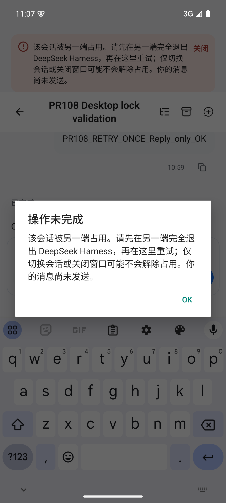
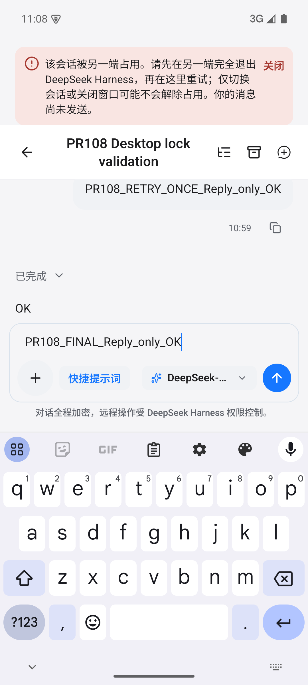
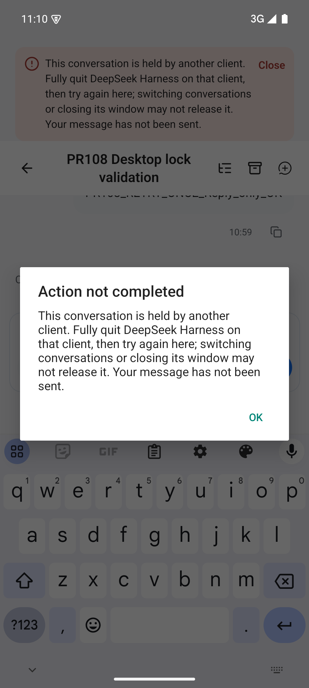
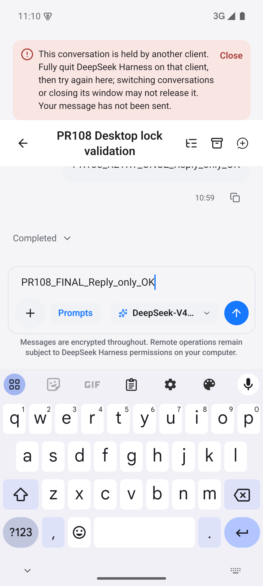
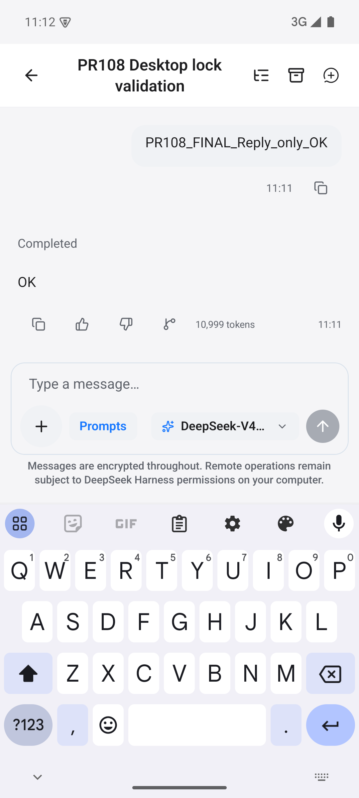
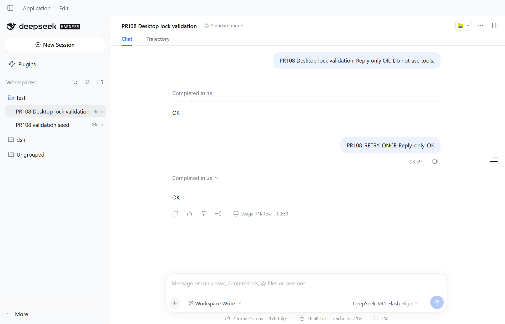

# PR #108 — Windows + Android 原生验收

验证代码提交：`8b3dec3b6006b26fdee658b821bdfdb287426991`。

## 范围与环境

- Windows 11。
- 官方 DeepSeek Harness Desktop `0.2.0-rc.2`，从官方更新 feed 下载并按 feed 的 SHA512 校验后解包运行，不使用第三方桌面壳。
- 独立 web Host：Harness `0.2.0-rc.1` + Remote Plugin `0.4.27`。Desktop 与 web Host 是两个真实 Host 进程，共享会话存储；不能将本次结果写成两端均为 rc.2。
- Android App `0.5.6`，本 PR 源码 + 两条指引修复；Android 15 / API 35 / x86_64 AVD，原生 debug APK。
- App 经真实 Remote 账号、Noise 加密通道和 P2P/LAN 路径连接 Host；不是注入错误或伪造 Host 响应。debug APK 的 JS 由已核对归属的 Metro 下发；生产 Hermes export 另行验证。

## 实际验收结果

1. Desktop 创建测试会话并取得真实模型 `OK` 回复，保持该会话的写句柄。
2. Android 打开同一会话，发送测试消息，中文与英文均显示可操作的友好横幅和「操作未完成」弹窗，不再显示底层错误原文。
3. 弹窗关闭后，原草稿完整保留；不自动重试，不伪造已发送消息。
4. 原始指引要求切换/关闭会话，但实测 Desktop 切换 New Session 后旧会话仍被占用。Win32 semaphore 探针确认 busy。仅关闭桌面窗口也可能只是隐藏，因此修正了两条语言文案，要求完全退出另一端 Harness。
5. 完全结束该测试 Desktop 的 shell 和 owned Host 后，命名 semaphore 不存在。退出通过 Electron `Browser.close` 请求，测试进程收据为 exit 0；**不声称托盘 Exit 按钮路径已验收**。
6. 在 Android 手动重试恢复的草稿，真实模型回复 `OK`，界面显示 Completed，草稿清空。
7. 原始验证拒绝前/后 compressed 日志 SHA256 相同：`240ad7e13dcbc00b340c27bd7ea07e1b0963a39b9b837b7c665a2f69ea0988c0`，13427 字节、22 行。
8. 修复后英文拒绝的发送前/后 compressed 日志 SHA256 相同：`f6933e581358069465250358be250b5ab1f7958394fdba238853833fd62afd76`，28965 字节、37 行。
9. 最终重试消息 `PR108_FINAL_Reply_only_OK` 的持久 `user/message` **恰好 1 条**（seq 40）；真实 `assistant/message` seq 43 文本 `OK`，turn 3 完成。最终 compressed 原始日志 SHA256：`6107acfe06f430bc50912e39ee47f996c55511c90c90e430ed4ad6a5642d3d7c`。

## 代码修复

仅修改中英文各一条 `session/writer-held` 指引；没有改变错误识别、写锁保护、发送、草稿恢复或重试逻辑，没有新增锁抢占/闲时释放/自动重放。

中文：
> 该会话被另一端占用。请先在另一端完全退出 DeepSeek Harness，再在这里重试；仅切换会话或关闭窗口可能不会解除占用。你的消息尚未发送。

英文：
> This conversation is held by another client. Fully quit DeepSeek Harness on that client, then try again here; switching conversations or closing its window may not release it. Your message has not been sent.

## 检查与限制

- 全仓 `pnpm -r check` 通过。
- Android：18 个测试文件，90 项测试全部通过。
- Android 生产 Hermes export 通过。
- 原生 x86_64 debug APK 编译、原地安装及真实界面验证通过；267 个 Gradle 任务。最后两条文案是 JS 修改，使用新 Metro bundle 复验，未将旧截图当作最终截图。
- Windows 全仓 `pnpm -r test`：531 项中 529 通过、2 失败。失败均为原有 `packages/plugin/tests/codex-domain.test.ts` 的平台假设：点开头目录必须 hidden=true，以及 cwd 必须以 `/allowed` 结尾。暂存本次修复、回到原 PR 提交单独复跑仍是同样 2 失败 / 11 通过，故不是本 PR 引入。未跳过失败，也未将全仓本地测试记为全部通过；未在该错误文案 PR 中夹带无关 CodeX 修复。
- `git diff --check` 通过。
- Metro 的 noble/hashes exports fallback、crypto require cycle 和 Gradle 弃用警告属于已观察到的构建/开发警告；不隐瞒为零警告。
- 不覆盖真机、其他 Android/DSH 版本、休眠/网络切换、长期稳定性、闲时自动释放或多写者能力。

## 证据格式说明

哈希及原始字节数均指 compressed `session.v4.jsonl.zstd`。decoded JSONL 的字节数不能直接比较：初始压缩 13427 字节解压为 UTF-8 LF 39380 字节；Windows CRLF 保存为 39402 字节，逻辑都是 22 行。原始历史压缩快照已从真实追加日志中恢复等长前缀，并要求与当时记录的 SHA256 完全一致，未重压缩或构造事件。Native 重开追加的 `session/end-seed` seq 35 与发送拒绝分开归因。

原始会话内容、账号、认证日志与含路径的 settings/workspace XML 仅保留本地，不公开；以下六张当前截图均已做隐私检查。

## 六张当前运行截图

| 中文弹窗 | 中文横幅与草稿 |
|---|---|
|  |  |
| **英文弹窗** | **英文横幅与草稿** |
|  |  |
| **完全退出后手动重试成功** | **真实 Windows Desktop** |
|  |  |
